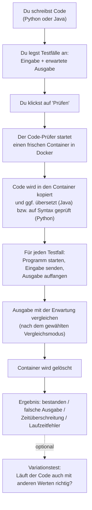

# Code-Prüfer

**Programmieraufgaben automatisch und sicher auf dem eigenen Computer prüfen.**

Dieses Programm ist für Schülerinnen, Schüler und Studierende gedacht (und für Lehrkräfte). Du schreibst ein kleines Programm in **Python** oder **Java**, der Code-Prüfer testet es – und sagt dir, ob es richtig arbeitet.

> Du willst das Programm nur **benutzen**? Dann bist du hier richtig.
> Du willst es **weiterentwickeln**? Dann lies [`CONTRIBUTING.md`](CONTRIBUTING.md).

---

## About (English summary)

Code-Prüfer is a free desktop application for Windows and macOS that checks programming exercises (Python and Java) locally against test cases: each program runs in an isolated Docker or Podman container without network access, and no code ever leaves the computer. Optional AI features use a local model (llama.cpp) to suggest test cases. The project is open source under the [MIT License](LICENSE); see the [Code signing policy](#code-signing-policy) ([`docs/CODE_SIGNING_POLICY.md`](docs/CODE_SIGNING_POLICY.md)) for what is signed, the team roles and the privacy policy.

---

## Inhalt

1. [Was ist der Code-Prüfer?](#1-was-ist-der-code-prüfer)
2. [Was du brauchst (Systemvoraussetzungen)](#2-was-du-brauchst-systemvoraussetzungen)
3. [Installation Schritt für Schritt](#3-installation-schritt-für-schritt)
4. [Erster Start](#4-erster-start)
5. [So funktioniert das Programm](#5-so-funktioniert-das-programm)
6. [Bedienung Schritt für Schritt](#6-bedienung-schritt-für-schritt)
7. [Häufige Probleme und Lösungen](#7-häufige-probleme-und-lösungen)
8. [Datenschutz in Kürze](#8-datenschutz-in-kürze)
9. [Weiterentwickeln und Lizenz](#9-weiterentwickeln-und-lizenz)

Außerdem: [About (English summary)](#about-english-summary) · [Code signing policy](#code-signing-policy)

---

## 1. Was ist der Code-Prüfer?

Stell dir vor, du bekommst im Unterricht diese Aufgabe: *„Lies eine Zahl ein und gib das Doppelte aus.“* Du schreibst ein Programm. Aber stimmt es auch? Normalerweise muss jemand es von Hand ausprobieren.

Der Code-Prüfer macht das für dich:

- Du gibst deinen **Code** ein (oder lädst eine Datei hoch).
- Du legst **Testfälle** an. Ein Testfall besteht aus einer **Eingabe** („Das tippt jemand ein“) und der **erwarteten Ausgabe** („Das soll das Programm antworten“).
- Du drückst auf **„Prüfen“**. Der Code-Prüfer startet dein Programm mit jeder Eingabe und vergleicht die Antwort mit dem, was erwartet wird.
- Du siehst pro Testfall: **bestanden** oder nicht – und bei Fehlern genau, was anders war.

Das Programm läuft **komplett auf deinem Computer**. Es gibt keinen Server im Internet, an den dein Code geschickt wird.

Außerdem gibt es optionale **KI-Funktionen** (KI = „künstliche Intelligenz“). Die KI läuft ebenfalls nur auf deinem Computer. Sie kann zum Beispiel:

- aus einem Aufgabenblatt **Testfälle vorschlagen**,
- Fehler korrigieren, wenn ein **eingescanntes Aufgabenblatt** nicht sauber gelesen wurde.

Die KI ist nur eine Hilfe. Ob dein Code richtig ist, entscheidet immer das **tatsächliche Ausführen** deines Programms – nie die KI.

---

## 2. Was du brauchst (Systemvoraussetzungen)

| Was | Details |
|---|---|
| **Betriebssystem** | **Windows**: ein aktuelles Windows 10 oder 11 (64 Bit). Der Code-Prüfer nutzt zum Lesen von Bildern und PDF-Dateien Funktionen, die Windows selbst mitbringt (`Windows.Media.Ocr` für die Texterkennung und `Windows.Data.Pdf` für PDF-Seiten). Dein Windows muss diese Funktionen haben; eine bestimmte Build-Nummer ist im Programm nicht festgelegt. **macOS**: ebenfalls aktuell. Dort nutzt das Programm die Apple-Funktionen *Vision* (Texterkennung) und *PDFKit* (PDF-Seiten). Es gibt Installationsdateien für Apple Silicon und Intel-Macs. |
| **Prozessor** | Muss **Virtualisierung** unterstützen (nur Windows, siehe Abschnitt 3). Fast alle Prozessoren der letzten Jahre können das. |
| **Container-Programm** | **Docker Desktop** (empfohlen) oder **Podman**. Unter Windows kann der Installer des Code-Prüfers die gewählte Engine für dich installieren. |
| **Arbeitsspeicher (RAM)** | Mindestens **8 GB**, bzw. so viel, dass dein Betriebssystem auch mit Docker/Podman im Hintergrund noch flüssig läuft. Für die **KI-Funktionen** gilt zusätzlich die Tabelle unten: Unter 12 GB RAM schlägt die App das kleine Modell vor, ab 12 GB das große. Unter 6 GB RAM warnt die App, dass es knapp wird. |
| **Speicherplatz** | Etwa **10 GB** frei (Code-Prüfer mit den Java-/Python-Umgebungen, Docker Desktop bzw. Podman und ein KI-Modell von ca. 1,2 GB oder 4,4 GB). |
| **Internet** | Nur zum Installieren, zum Herunterladen des KI-Modells und für Updates. Zum Prüfen von Code brauchst du **kein** Internet. |

**Welches KI-Modell passt zu meinem Rechner?**

| Dein Arbeitsspeicher | Vorschlag der App | Dateigröße | Dauer pro Aufgabe (Schätzung der Entwickler, nicht auf Schul-PCs gemessen) |
|---|---|---|---|
| unter 12 GB | Qwen2.5-Coder 1.5B (klein, schneller, etwas schwächer) | ca. 1,2 GB | ca. 1–4 Minuten |
| ab 12 GB | Qwen2.5-Coder 7B (größer, besser, langsamer) | ca. 4,4 GB | ca. 4–10 Minuten |

Hat dein Prozessor kein sogenanntes *AVX2* (eine Rechenfunktion), warnt dich die App: Die KI ist dann sehr langsam. Die KI ist freiwillig – ohne sie funktioniert das Prüfen trotzdem.

---

## 3. Installation Schritt für Schritt

Zuerst ein paar Begriffe, damit du weißt, wozu das alles nötig ist:

- **Container:** Eine Art „Mini-Computer im Computer“. Er ist von deinem echten Windows (bzw. macOS) streng abgetrennt. Der Code-Prüfer startet dein Programm *darin*. Dein Programm kann so nichts auf deinem Rechner kaputt machen und hat kein Internet.
- **Container-Engine:** Das Programm, das solche Container verwaltet und startet. Der Code-Prüfer unterstützt zwei: **Docker Desktop** (empfohlen, die Voreinstellung) und **Podman**.
- **Virtualisierung:** Eine Fähigkeit deines Prozessors, „virtuelle“ Computer zu betreiben. Docker und Podman brauchen sie. Sie kann im Windows oder im **BIOS/UEFI** (dem Grundprogramm deines Computers, das vor Windows startet) ausgeschaltet sein.
- **WSL 2:** „Windows-Subsystem für Linux, Version 2“. Eine Windows-Funktion, auf der Docker Desktop und Podman unter Windows aufbauen.
- **Admin-Rechte:** Für einige Schritte brauchst du Administratorrechte. Auf einem Schulrechner darfst du das vielleicht nicht – frag dann deine IT-Betreuung.

**Gute Nachricht:** Du musst Docker oder Podman **nicht vorher selbst installieren**. Der Installer des Code-Prüfers übernimmt das auf Wunsch für dich (Windows, siehe Schritt 1).

### Windows

#### Schritt 1: Den Code-Prüfer installieren (mit Container-Engine)

1. Öffne die Download-Seite (die sogenannte **Releases-Seite** auf GitHub): <https://github.com/BernhardGoetz/CodeChecker/releases>
2. Nimm das **neueste Release** (ganz oben, **nicht** eines, das „QAS“ im Namen trägt – das sind Testversionen).
3. Lade unter **„Assets“** die Windows-Datei herunter. Sie heißt so: `Code-Pruefer_<Version>_x64-setup.exe` (statt `<Version>` steht eine Zahl wie `1.0.1`).
4. Starte die heruntergeladene Datei.
5. **Windows-Warnung „Der Computer wurde durch Windows geschützt“ (SmartScreen):** Der Windows-Installer ist **zurzeit noch nicht signiert** (die kostenlose Signierung über die SignPath Foundation wird beantragt, siehe [Code signing policy](#code-signing-policy)). Deshalb zeigt Windows diese Meldung, weil es die Installationsdatei noch nicht kennt.
   - Klicke auf **„Weitere Informationen“**.
   - Dann erscheint der Knopf **„Trotzdem ausführen“**. Klicke darauf.
   - Mach das bitte **nur**, wenn du die Datei selbst von der oben genannten GitHub-Seite geladen hast.
6. Der Installer ist auf Deutsch. Du siehst eine Seite **„Container-Engine“**. Wähle:
   - **Docker Desktop (empfohlen)** – die Voreinstellung. Kostenlos für private Nutzung und Bildung; lies die Lizenzbedingungen bitte selbst.
   - **Podman** – eine Open-Source-Alternative. Die „Podman-Maschine“ wird erst beim ersten Start des Code-Prüfers eingerichtet.

   Beide brauchen unter Windows WSL 2. Die Engine kann später in der App umgestellt werden.
7. Klicke dich durch den Installer. **Ist die gewählte Engine noch nicht installiert**, fragt dich der Installer am Ende, ob er sie jetzt automatisch installieren soll (über *winget*, den Windows-Paketmanager). Antworte mit **„Ja“**:
   - Windows fragt nach **Administratorrechten**. Die Installation kann einige Minuten dauern und einen **Neustart** erfordern. Starte den Computer neu, wenn Windows das verlangt.
   - Steht *winget* auf deinem Rechner nicht zur Verfügung, oder schlägt die Installation fehl, kann der Installer stattdessen die offizielle Download-Seite öffnen (<https://www.docker.com/products/docker-desktop/> bzw. <https://podman.io/>). Dann installierst du die Engine von Hand. Der Code-Prüfer selbst wird trotzdem installiert.
   - Bei „Nein“ wird nichts installiert, du kannst die Engine später selbst nachholen.
   - Läuft der Installer „still“ oder „passiv“ (z. B. bei einem Update aus der App), wird nichts gefragt und nichts nachinstalliert.

Der Code-Prüfer wird für deinen Windows-Benutzer installiert.

#### Schritt 2: Was beim ersten Start passiert

Starte den **Code-Prüfer**. Er sucht die gewählte Engine und **startet sie selbst** (Docker Desktop bzw. Podman), wenn sie nicht läuft; dabei wartet er bis zu zwei Minuten. Es kann beim allerersten Mal trotzdem Handarbeit nötig sein:

**Docker Desktop (erster Start):**

1. Falls Docker Desktop nicht von selbst aufgeht: Starte es über das Startmenü.
2. Beim ersten Start musst du die **Lizenzbedingungen akzeptieren**.
3. Eine **Anmeldung (Konto) kannst du überspringen** (z. B. mit „Skip“ oder „Continue without signing in“).
4. Warte, bis in Docker Desktop **„Engine running“** (grünes Symbol) steht. Das kann beim ersten Mal eine Weile dauern.
5. **Test, ob alles klappt** (optional): Öffne PowerShell und tippe:

   ```powershell
   docker run hello-world
   ```

   Wenn alles stimmt, erscheint unter anderem **„Hello from Docker!“**. (Dafür braucht der Rechner einmalig Internet.)
6. Zurück im Code-Prüfer: oben muss **„Docker Desktop … läuft“** stehen (sonst „Erneut prüfen“ klicken).

**Podman (erster Start):**

- Gibt es noch keine „Podman-Maschine“ (eine kleine virtuelle Linux-Umgebung, in der Podman arbeitet), richtet der Code-Prüfer sie **einmalig selbst ein** (`podman machine init`) und startet sie dann (`podman machine start`). Dabei wird ein Image heruntergeladen – das braucht **Internet** und kann **einige Minuten** dauern (einige hundert MB).
- Unter Windows braucht Podman WSL 2. Schlägt die Einrichtung fehl, nennt die App dasselbe: In einer **PowerShell als Administrator** `wsl --install` ausführen, danach neu starten.

**Wenn Docker/Podman nicht starten – Fehlersuche in dieser Reihenfolge:**

Typisch beim ersten Start von Docker Desktop: Es zeigt eine Meldung wie **„Virtualization support not detected“** (sinngemäß: Virtualisierung ist nicht aktiv) und blendet einen Befehl für die Eingabeaufforderung (CMD) ein.

**Fix 1 – Windows-Hypervisor einschalten (zuerst versuchen):**

1. Klicke auf Start, tippe **cmd**, mache einen Rechtsklick auf „Eingabeaufforderung“ und wähle **„Als Administrator ausführen“**.
2. Tippe diesen Befehl und drücke Enter:

   ```bat
   bcdedit /set hypervisorlaunchtype auto
   ```
3. **Starte den Computer neu**, danach Docker Desktop erneut starten.


**Fix 2 – Virtualisierung im BIOS/UEFI einschalten (Rückfallebene):** Der Befehl aus Fix 1 schaltet nur den Hypervisor **in Windows** ein. Ist die **Hardware-Virtualisierung im BIOS/UEFI ausgeschaltet**, hilft der Befehl allein **nicht**. Dann musst du sie dort aktivieren:

*Erst prüfen, ob sie schon an ist:*

1. Drücke `Strg` + `Umschalt` + `Esc` (Task-Manager; ggf. unten links „Mehr Details“).
2. Klicke links auf **„Leistung“** und dann auf **„CPU“**.
3. Rechts unten steht **„Virtualisierung:“**. Steht dort **„Aktiviert“**, ist die Hardware-Virtualisierung in Ordnung (dann liegt es eher an Fix 1 oder an WSL, siehe Fix 3). Steht dort **„Deaktiviert“**, mache weiter:

*Im BIOS/UEFI einschalten:*

1. Speichere alles; der Computer wird gleich neu gestartet.
2. Starte **ins BIOS/UEFI**:
   - **Weg 1 (über Windows):** *Einstellungen* → **System** → **Wiederherstellung** → bei „Erweiterter Start“ **„Jetzt neu starten“** → **Problembehandlung** → **Erweiterte Optionen** → **UEFI-Firmwareeinstellungen** → **Neu starten**.
   - **Weg 2 (Taste beim Start):** Neu starten und beim Hersteller-Logo mehrfach eine Taste drücken, typisch `Entf`, `F2`, `F10`, `F12` oder `Esc` (steht meist kurz auf dem Startbildschirm).
3. Suche die Virtualisierungs-Option (oft unter *Advanced*, *CPU Configuration* oder *Security*):
   - **Intel:** „Intel Virtualization Technology“ / „Intel VT-x“ / „VT-x“
   - **AMD:** „SVM Mode“ / „SVM“ / „AMD-V“
4. Stelle sie auf **Enabled**, **speichern und beenden** (meist `F10`), der Computer startet neu.
5. Prüfe im Task-Manager noch einmal: Jetzt muss **„Aktiviert“** stehen.

Tipp: Jedes BIOS sieht anders aus. Suche im Internet nach *„Virtualisierung aktivieren“* plus der Modellbezeichnung deines Computers.

**Fix 3 – WSL 2 einrichten oder aktualisieren:**

1. PowerShell **als Administrator** öffnen (Rechtsklick auf „Windows PowerShell“ → „Als Administrator ausführen“).
2. Ausführen:

   ```powershell
   wsl --install
   ```

   Danach **neu starten**, wenn Windows es verlangt. Falls ein Linux-Fenster (meist „Ubuntu“) nach Benutzername und Passwort fragt: eintragen und merken.
3. Zur Sicherheit aktualisieren:

   ```powershell
   wsl --update
   ```

`wsl --install` schaltet auch die nötigen Windows-Funktionen ein, vor allem **„Virtual Machine Platform“** und das „Windows-Subsystem für Linux“. Von Hand geht das so: Start → `optionalfeatures` eintippen → diese beiden Häkchen setzen → neu starten.

**Typische Fehlermeldungen** (der genaue Wortlaut kann je nach Docker-Version abweichen):

| Meldung | Lösung |
|---|---|
| **„Virtualization support not detected“** (oder: „Hardware assisted virtualization … must be enabled in the BIOS“) | Fix 1, danach Fix 2 (BIOS/UEFI). |
| **„WSL 2 installation is incomplete“** oder „WSL needs updating“ | Fix 3: `wsl --install` und `wsl --update`, neu starten. |
| Docker Desktop hängt bei „Starting the Docker Engine …“ | Geduld (mehrere Minuten). Sonst: Docker Desktop beenden, Computer neu starten, Docker Desktop erneut starten, `wsl --update` ausführen. |
| „Access denied“ / „Zugriff verweigert“ (in Docker oder im Code-Prüfer) | Dein Windows-Benutzer muss Mitglied der Gruppe **„docker-users“** sein (ein Administrator kann das unter *Computerverwaltung → Lokale Benutzer und Gruppen → Gruppen → docker-users* einstellen). Danach abmelden und neu anmelden. |
| Die Engine lässt sich gar nicht installieren | Schulrechner sind oft gesperrt. Frag deine IT-Betreuung, ob Docker Desktop bzw. Podman erlaubt ist. |

### macOS

Es gibt Installationsdateien für **Apple Silicon** (`…_aarch64.dmg`) und **Intel-Macs** (`…_x64.dmg`) auf der [Releases-Seite](https://github.com/BernhardGoetz/CodeChecker/releases). Einen BIOS-Schritt gibt es auf dem Mac nicht.

1. **Container-Engine installieren:** Hier installiert **der Code-Prüfer nichts nach** (der Engine-Auswahl-Schritt gehört zum Windows-Installer). Installiere vorher **Docker Desktop für Mac** (<https://www.docker.com/products/docker-desktop/>) oder **Podman** (<https://podman.io/>). Docker Desktop erwartet die App unter `/Applications/Docker.app`.
2. **Code-Prüfer installieren:** DMG öffnen und „Code-Prüfer“ in den Ordner „Programme“ ziehen.
3. **Erster Start:** Die Mac-Version ist noch **nicht signiert**; macOS blockiert den ersten Start. Im Finder mit **Rechtsklick** auf „Code-Prüfer“ → **„Öffnen“** → noch einmal **„Öffnen“** bestätigen. (Alternativ im Terminal: `xattr -dr com.apple.quarantine "/Applications/Code-Prüfer.app"`.)
4. **Engine:** Der Code-Prüfer startet Docker Desktop bzw. Podman beim Start selbst. Docker Desktop: beim ersten Start Lizenzbedingungen akzeptieren, warten bis „Engine running“. Podman: Die „Podman-Maschine“ wird beim ersten Start einmalig eingerichtet (`podman machine init`, Internet nötig, einige Minuten); den `podman`-Befehl findet die App auch unter `/opt/podman/bin`, `/opt/homebrew/bin` und `/usr/local/bin`.


### Linux

Für Linux gibt es keine fertigen Installer. Es gibt auch keine Texterkennung und keinen automatischen Start der Engine; Entwicklerinnen und Entwickler finden Hinweise in [`CONTRIBUTING.md`](CONTRIBUTING.md).

---

## 4. Erster Start

Starte den **Code-Prüfer** über das Startmenü. Oben im Fenster siehst du ein kleines Statuslämpchen mit Text zur **Container-Engine** (Docker Desktop oder Podman, je nachdem, was du gewählt hast).

### Die Engine wird erkannt

Der Code-Prüfer sucht beim Start selbst nach der gewählten Engine (Einzelheiten zum allerersten Start stehen in Abschnitt 3, Schritt 2):

- **„Docker Desktop … läuft“** (grünes Lämpchen): Alles gut.
- **„Docker Desktop ist nicht gestartet“** (bzw. „Podman …“, gelb): Der Code-Prüfer versucht, die Engine **von selbst zu starten** und wartet bis zu zwei Minuten. Du kannst auch oben auf **„Docker Desktop starten“** (bzw. „Podman starten“) klicken oder sie selbst öffnen und dann **„Erneut prüfen“** drücken.
- **„Keine Container-Engine gefunden“** (rot): Die Engine ist nicht installiert (oder der Code-Prüfer findet sie nicht). Unter der Kopfzeile erscheint ein Hinweis mit Download-Link. → Installiere Docker Desktop oder Podman (siehe [Abschnitt 3](#3-installation-schritt-für-schritt)); unter Windows geht das über den Installer des Code-Prüfers.

### Die Prüf-Umgebungen für Python und Java

Der Code-Prüfer bringt „Bauanleitungen“ für die Container (sogenannte **Images**) für Python und Java gleich im Installationspaket mit. Beim ersten Start mit laufendem Docker lädt er sie automatisch in Docker. Dafür brauchst du **kein Internet**. Der Fortschritt steht neben dem Knopf „Prüfen“. Solange das läuft, ist „Prüfen“ kurz gesperrt.

### KI-Modell einrichten (freiwillig)

Das brauchst du nur, wenn du die KI-Funktionen nutzen willst (Testfälle erzeugen lassen, Texterkennungsfehler korrigieren lassen). Zum Prüfen von Code ist die KI **nicht** nötig.

1. Klicke oben rechts auf das **Zahnrad** (Einstellungen) und dann bei „KI-Modell“ auf **„KI-Modell verwalten …“**. (Alternativ: im Tab „Testfälle“ auf **„KI-Modell einrichten …“** klicken.)
2. Du siehst eine Liste mit zwei Modellen. Das für deinen Rechner passende trägt das Kennzeichen **„empfohlen“**. Oben steht, wie viel Arbeitsspeicher dein Rechner hat.
3. Klicke beim empfohlenen Modell auf **„Herunterladen“**. Ein Fortschrittsbalken zeigt den Download. Der Download wird auf Korrektheit geprüft (Prüfsumme). Bricht er ab, kannst du ihn mit **„Download fortsetzen“** weiterführen.
4. Wenn das Modell fertig ist, klicke auf **„Auswählen“**. Es erscheint das Kennzeichen **„ausgewählt“**.

Ab jetzt läuft die KI ohne Internet. Der Download kommt von `huggingface.co` (eine bekannte Plattform für KI-Modelle).

**Kein Internet am Lernrechner?** Dann lade die Modelldatei (`.gguf`) auf einem anderen Rechner herunter, kopiere sie per USB-Stick und nutze in der Modellverwaltung **„Weitere Optionen (ohne Internet)“ → „Datei importieren …“**. Die App sagt dir dort genau, welche Datei sie erwartet und wo du sie findest.

---

## 5. So funktioniert das Programm

### Der Weg vom Code zum Ergebnis



### Die einzelnen Bausteine

**Code, Eingabe und Ausgabe.** Die Programme lesen ihre Eingaben von der **Standardeingabe** („stdin“, bei Python z. B. `input()`) und schreiben ihre Ergebnisse auf die **Standardausgabe** („stdout“, bei Python z. B. `print()`). Genau das testet der Code-Prüfer: Eingabe rein, Ausgabe raus, vergleichen.

**Docker-Container als Sicherheitsraum.** Jede Prüfung bekommt einen **frischen Container**, der danach immer gelöscht wird. Darin gilt:
- **kein Netzwerk** und das Dateisystem kann nicht verändert werden (nur ein kleiner Arbeitsbereich im Arbeitsspeicher),
- nur 512 MB Arbeitsspeicher, 1 Prozessorkern und höchstens 64 Prozesse,
- **Zeitlimit pro Test:** Python 5 Sekunden, Java 8 Sekunden (Kompilieren: 30 Sekunden). Eine Endlosschleife wird also abgebrochen.
- Der Code läuft ohne besondere Rechte (kein Administrator).

So kann auch fremder oder fehlerhafter Code deinen Rechner nicht beschädigen.

**Python und Java.** Für jede Programmiersprache gibt es ein eigenes Container-Paket (Image). Bei Java muss die Hauptklasse **`Main`** heißen (die Datei wird intern als `Main.java` gespeichert), sonst gibt es einen Hinweis.

**Testfälle.** Du kannst bis zu **50 Testfälle** pro Prüfung anlegen, von Hand oder mit der KI. Ein Testfall besteht aus Name, Eingabe und erwarteter Ausgabe.

**Vergleichsmodi.** Wie streng soll die Ausgabe mit der Erwartung verglichen werden? Du wählst über den Testfällen bei **„Vergleich:“**:

| Modus | Bedeutung |
|---|---|
| **Zeilen (exakt)** (Standard) | Zeile für Zeile gleich. Leerzeichen am Zeilenende und leere Zeilen ganz am Ende werden ignoriert (abschaltbar). |
| **Wörter (Leerraum egal)** | Nur die Wörter zählen. Leerzeichen, Tabs und Zeilenumbrüche sind egal. Groß-/Kleinschreibung zählt. |
| **Zahlen mit Toleranz** | Wie „Wörter“, aber Zahlen dürfen leicht abweichen (z. B. `0.3333334` statt `0.3333333`). Die erlaubte Abweichung stellst du als „Toleranz“ ein (Voreinstellung `1e-6`, also 0,000001). Alles, was keine Zahl ist, muss exakt passen. |

Zusätzlich gibt es die Option **„Zeilenumbruch am Ende verbieten“**: Dann gilt eine Ausgabe, die mit einem Zeilenumbruch endet (z. B. durch `println` oder `print()`), als nicht bestanden – egal, was erwartet wird.

**Ergebnisse.** Pro Testfall siehst du einen Status:

| Status | Bedeutung |
|---|---|
| **Bestanden** | Die Ausgabe stimmt. |
| **Falsche Ausgabe** | Die Ausgabe weicht ab. Darunter siehst du einen Zeilenvergleich („erwartet“ gegen „tatsächlich“). |
| **Zeitüberschreitung** | Das Programm war zu langsam, z. B. eine Endlosschleife – oder es wartet auf eine Eingabe, die der Testfall nicht liefert. |
| **Laufzeitfehler** | Das Programm ist abgestürzt (z. B. eine Ausnahme/Exception). |
| **Fehler** | Die Prüfumgebung selbst ist ausgefallen. |
| **Ausgabeformat weicht von Vorlage ab** | Siehe unten bei „Ausgabevorlagen“. |
| **Nur für die gegebenen Werte richtig** | Siehe unten bei „Variationstest“. |

Lässt sich dein Code gar nicht übersetzen, siehst du statt der Testfälle einen **Kompilierfehler** mit der Meldung des Compilers.

**Aufgabenblatt hochladen (Tab „Aufgabe“).** Du kannst die Aufgabenstellung einfügen oder über **„Aufgabe hochladen …“** eine Datei laden: **Word (.docx), PDF oder Bild (PNG, JPEG)**, höchstens 20 MB und 20 Seiten. Der Text wird auf deinem Computer gelesen. Bei Bildern und eingescannten PDF-Seiten benutzt die App die **Texterkennung (OCR)** von Windows bzw. macOS. Unter Windows muss dafür eine Sprache mit Texterkennung installiert sein (*Einstellungen → Zeit und Sprache → Sprache*). Erkannter Text kann Fehler enthalten (z. B. `0` statt `O` oder `1` statt `l`) – deshalb musst du ihn prüfen und das Häkchen **„Text geprüft und korrigiert“** setzen.

**KI: „Testfälle mit KI erzeugen“ (Tab „Testfälle“).** Die KI geht so vor – und die Reihenfolge ist wichtig:
1. Sie liest die Aufgabe und schreibt **mehrere eigene Lösungen** (je nach Modell 5 oder 3) und **Testeingaben**.
2. Die Lösungen werden in der Sandbox (im Container) wirklich **ausgeführt**.
3. Die **erwartete Ausgabe** ist die, auf die sich die Mehrheit der Lösungen einigt. Die KI *schreibt* die erwarteten Ausgaben also nie selbst.
4. Du bekommst eine **Konfidenz** (Vertrauensstufe): **Grün** = hohe Sicherheit (die Beispiele des Aufgabenblatts bestanden, die Lösungen sind sich einig), **Gelb** = nur ein Hinweis, bitte die erwarteten Ausgaben prüfen, **Rot** = keine verlässlichen Testfälle möglich (dann gibt es auch keine).

Die erzeugten Testfälle werden an deine vorhandenen angehängt und mit **„KI“** markiert. Du kannst sie bearbeiten. Bei Aufgaben ohne Beispiele, mit mehreren richtigen Lösungen, mit Zufall, GUI oder Dateien ist das Ergebnis höchstens ein Hinweis.

**Ausgabevorlagen.** Manche Aufgabenblätter zeigen nur das *Format* der Ausgabe mit einem Platzhalter, z. B. „12345678 seconds have passed“. Erkennt die KI so eine Vorlage, wird sie beim Prüfen nur als **Formatprüfung** genutzt (nicht als feste Erwartung). Unter „Testfälle mit KI“ siehst du die erkannte Vorlage und kannst sie mit **„Vorlage nicht verwenden“** verwerfen. Das ist nützlich, wenn eigene Randfälle (z. B. „Ungültige Eingabe“) absichtlich etwas anderes ausgeben.

**Variationstest.** Ein Programm kann *zufällig* das richtige Ergebnis liefern, obwohl die Rechnung falsch ist. Beispiel: Mit einer falschen Formel kommt für genau die Zahlen der Aufgabe das richtige Ergebnis heraus, mit anderen Zahlen aber nicht. Der Variationstest ändert deshalb Werte und lässt deinen Code **und** die Musterlösung der KI laufen. Weicht dein Code ab, bekommen bisher bestandene Tests den Status „Nur für die gegebenen Werte richtig“. Der Variationstest läuft nur, wenn
- dein Code kompiliert und mindestens ein Test bestanden ist,
- vorher „Testfälle mit KI erzeugen“ für genau diesen Aufgabentext gelaufen ist (daher kommt die Musterlösung),
- ein KI-Modell eingerichtet ist.

Er ist ein starker Hinweis, aber kein Beweis (die Musterlösung ist ja selbst von der KI). Du kannst ihn mit dem Schalter neben „Prüfen“ ausschalten.

**OCR-Korrektur.** Wurde ein Aufgabenblatt per Texterkennung gelesen, gibt es unter dem Text die Schaltfläche **„Erkennungsfehler mit KI korrigieren“**. Die KI schlägt dann nur **kleine Zeichenkorrekturen** vor (z. B. `1`/`l`, `0`/`O`, fehlende Anführungszeichen oder Klammern). Jeder Vorschlag wird dir farbig gezeigt, und du entscheidest einzeln: **Übernehmen** oder **Verwerfen** – oder **„Alle übernehmen“**. Mit **„Ursprünglichen Text wiederherstellen“** gehst du zurück zum Rohtext. Es wird nichts automatisch geändert.

**Updates.** Die installierte Version sucht beim Start (danach höchstens einmal am Tag) auf GitHub nach einer neuen Version. Findet sie eine, erscheint **„Update verfügbar“** mit den Neuerungen. Mit **„Jetzt aktualisieren“** lädt die App das Update, prüft seine Signatur, installiert es und startet neu. Mit **„Später“** wirst du beim nächsten Mal wieder gefragt. **Achtung:** Beim Neustart gehen nicht gespeicherte Eingaben (Code, Testfälle) verloren. Unter *Zahnrad → Updates* kannst du einstellen, wie oft gesucht wird (täglich, wöchentlich, nie) oder sofort suchen.

**Was wird gespeichert?** Dein Code, die Aufgabe und die Testfälle werden **nicht** gespeichert. Wenn du das Programm schließt, sind sie weg. Kopiere dir deinen Code also vorher, wenn du ihn behalten willst. Gespeichert werden nur Einstellungen (z. B. Farbschema, gewählte Container-Engine, gewähltes KI-Modell, Update-Intervall).

---

## 6. Bedienung Schritt für Schritt

So sieht ein typischer Ablauf aus. Das Fenster hat oben den **Code-Editor** mit dem Knopf **„Prüfen“** und darunter drei Reiter: **Aufgabe**, **Testfälle**, **Ergebnis**.

1. **Docker prüfen:** Oben rechts muss stehen, dass Docker läuft (grünes Lämpchen). Wenn nicht, siehe [Erster Start](#4-erster-start).
2. **Sprache wählen:** Links über dem Editor wählst du **Python** oder **Java**. Im Editor steht schon ein kleines Beispielprogramm, das du überschreiben kannst. Bei Java muss die Klasse `Main` heißen.
3. **Code eingeben** – oder eine Datei (`.py` bzw. `.java`) in den Editor laden.
4. **Aufgabe eintragen (optional, nötig für die KI):** Im Tab **„Aufgabe“** den Text einfügen oder mit **„Aufgabe hochladen …“** laden. Den Text kontrollieren, ggf. korrigieren und **„Text geprüft und korrigiert“** anhaken.
5. **Testfälle anlegen:** Im Tab **„Testfälle“** mit **„+ Testfall hinzufügen“** einen Testfall erstellen. Trage die **Eingabe (stdin)** und die **erwartete Ausgabe (stdout)** ein. Beispiel: Eingabe `Welt`, erwartete Ausgabe `Hallo, Welt!`. Oder: mit **„Testfälle mit KI erzeugen“** vorschlagen lassen (dafür siehe KI-Einrichtung oben) und die Ergebnisse kritisch prüfen.
6. **Vergleich wählen:** Bei **„Vergleich:“** den Modus einstellen (meist reicht „Zeilen (exakt)“).
7. **Auf „Prüfen“ klicken.** Die App springt zum Tab **„Ergebnis“**. Oben steht z. B. **„3 von 4 Tests bestanden“**.
8. **Ergebnis lesen:** Bei jedem Testfall siehst du den Status, bei Fehlern den Vergleich **erwartet gegen tatsächlich**, dazu `stdout`, `stderr` (Fehlermeldungen) und die Laufzeit. Leerzeichen am Zeilenende erscheinen als `·` und ein Zeilenumbruch am Ende als `⏎`, damit du solche unsichtbaren Unterschiede findest.
9. **Code verbessern und erneut prüfen.**
10. Ist der **Variationstest** an, läuft er nach dem Ergebnis automatisch (wenn die Voraussetzungen erfüllt sind). Du siehst „Prüfe mit veränderten Werten …“ und kannst abbrechen.

**Einstellungen (Zahnrad oben rechts):** Farbschema (hell, dunkel, System), Container-Engine (Docker oder Podman) mit **„Images aktualisieren“**, KI-Modell verwalten, Updates.

---

## 7. Häufige Probleme und Lösungen

**„Keine laufende Container-Engine gefunden“ / „Docker Desktop ist installiert, aber nicht gestartet“**
Docker Desktop öffnen und warten, bis „Engine running“ dasteht. Dann im Code-Prüfer **„Erneut prüfen“** klicken. Die Meldung nennt zu jedem Verbindungsversuch einen Grund – der hilft bei der Suche. Bei „Zugriff verweigert“: Mitglied der Windows-Gruppe `docker-users` werden (siehe Abschnitt 3, Tabelle „Typische Fehlermeldungen“).

**Docker startet nicht („Virtualization support not detected“, „WSL 2 installation is incomplete“)**
Siehe [Abschnitt 3](#3-installation-schritt-für-schritt), „Wenn Docker/Podman nicht starten“: zuerst `bcdedit /set hypervisorlaunchtype auto` (CMD als Administrator, danach neu starten), dann ggf. Virtualisierung im BIOS/UEFI einschalten, dann `wsl --install` und `wsl --update`.

**„Das Runner-Image für … ist nicht vorhanden“**
Die Prüf-Umgebung konnte nicht geladen werden. Internet prüfen und unter *Zahnrad → Container-Engine* auf **„Images aktualisieren“** klicken – oder den Code-Prüfer neu installieren.

**Mein Test meldet „Zeitüberschreitung“, obwohl der Code stimmt**
Dein Programm wartet vielleicht auf mehr Eingaben, als der Testfall liefert. Die Eingabe muss **alle** Zeilen enthalten, die dein Programm liest (jedes `input()` braucht eine Zeile).

**„Falsche Ausgabe“, aber sie sieht gleich aus**
Oft ist es ein unsichtbarer Unterschied: ein Leerzeichen am Zeilenende oder ein Zeilenumbruch am Ende. Schau auf die Symbole `·` und `⏎` im Ergebnis. Probiere ggf. den Vergleichsmodus **„Wörter (Leerraum egal)“**.

**„Testfälle mit KI erzeugen“ ist ausgegraut**
Fahre mit der Maus darüber oder lies den Hinweis daneben. Meistens fehlt eines davon: Aufgabentext nicht als geprüft markiert, kein KI-Modell eingerichtet, eine Prüfung läuft noch, Docker startet gerade, die Prüf-Umgebungen werden noch vorbereitet.

**Die KI-Konfidenz ist Gelb oder Rot**
Lege Testfälle von Hand an oder prüfe die vorgeschlagenen erwarteten Ausgaben. Oft hilft ein klarerer Aufgabentext mit Beispielen.

**Tests zeigen „Ausgabeformat weicht von Vorlage ab“**
Im Tab „Testfälle“ prüfen, ob die erkannte Vorlage stimmt. Gilt sie nicht für diesen Testfall (z. B. bei einem Randfall), auf **„Vorlage nicht verwenden“** klicken und erneut prüfen.

**„Variationstest übersprungen“**
Der Hinweis nennt den Grund (z. B. keine Musterlösung vorhanden, kein KI-Modell). Das ist kein Fehler. Du kannst den Test mit dem Schalter neben „Prüfen“ abschalten.

**Die KI startet unter Windows nicht**
Es fehlt die **Microsoft Visual C++ Laufzeit**. Die App zeigt dazu einen Link zum Microsoft-Download an (`https://aka.ms/vs/17/release/vc_redist.x64.exe`).

**Keine Texterkennung unter Windows (Bild/PDF wird nicht gelesen)**
Installiere unter *Einstellungen → Zeit und Sprache → Sprache* eine Sprache mit Texterkennung, z. B. „Deutsch (Deutschland)“.

**Das KI-Modell lässt sich nicht herunterladen**
Prüfe die Internetverbindung (Download von `huggingface.co`). In Schulnetzen kann das gesperrt sein. Dann: Datei auf einem anderen Rechner laden und über „Weitere Optionen (ohne Internet)“ importieren.

**Die KI ist sehr langsam**
Das ist bei Rechnern ohne Grafikbeschleunigung normal. Wähle ggf. das kleinere Modell. Schließe andere Programme. Prüfe, ob die App eine AVX2-Warnung zeigt.

**macOS meldet beim Start „… kann nicht geöffnet werden“**
Die macOS-Version ist noch nicht signiert. Im Finder mit Rechtsklick auf „Code-Prüfer“ → **„Öffnen“** → noch einmal **„Öffnen“** bestätigen.

**Ich habe etwas geschlossen und mein Code ist weg**
Der Code-Prüfer speichert Code, Aufgaben und Testfälle nicht. Kopiere deinen Code in eine eigene Datei, bevor du das Programm schließt oder ein Update installierst.

---

## 8. Datenschutz in Kürze

- Dein **Code, deine Aufgaben und Testfälle verlassen deinen Rechner nie.**
- Es gibt **keine Benutzerkonten, keine Telemetrie** (Nutzungsdaten-Sammlung) und **keine Absturzberichte**.
- Das Programm nutzt das Internet nur für: den einmaligen Download des KI-Modells (`huggingface.co`), das Nachladen der Prüf-Umgebungen aus dem Internet (`ghcr.io`, nur falls nötig), die Suche nach Updates (`github.com`, abschaltbar), bei Podman das einmalige Einrichten der Podman-Maschine (Podman lädt dabei ein Image herunter) und – nur auf Nachfrage im Installer – die Installation von Docker Desktop bzw. Podman über *winget*.
- Docker Desktop selbst ist ein Programm eines anderen Herstellers und kann nach seinen eigenen Einstellungen Verbindungen aufbauen.
- Die verbindliche (englische) Fassung steht im Abschnitt „Privacy policy“ der [Code signing policy](docs/CODE_SIGNING_POLICY.md).

---

## 9. Weiterentwickeln und Lizenz

Wenn du am Code-Prüfer mitarbeiten willst (Fehler beheben, neue Programmiersprache oder neues KI-Modell ergänzen, das Programm selbst bauen), findest du alles Nötige in **[`CONTRIBUTING.md`](CONTRIBUTING.md)**.

**Lizenz:** [MIT-Lizenz](LICENSE), © 2026 Bernhard Götz. Du darfst das Programm frei nutzen, verändern und weitergeben. Die mitgelieferte Drittsoftware (u. a. llama.cpp) steht in [`THIRD_PARTY_NOTICES.txt`](THIRD_PARTY_NOTICES.txt).

**Weitere Dokumente:** [`CHANGELOG.md`](CHANGELOG.md) (Änderungen je Version), [`docs/UPDATER.md`](docs/UPDATER.md) (Wie Updates funktionieren), [Code signing policy](#code-signing-policy) ([`docs/CODE_SIGNING_POLICY.md`](docs/CODE_SIGNING_POLICY.md)), [`SECURITY.md`](SECURITY.md) (Sicherheitslücken vertraulich melden).

---

## Code signing policy

Die vollständige Richtlinie (englisch, verbindlich): [`docs/CODE_SIGNING_POLICY.md`](docs/CODE_SIGNING_POLICY.md)

**Stand:** Die kostenlose Code-Signierung der Windows-Programmdateien über die SignPath Foundation wird beantragt und ist **noch nicht genehmigt**. Bis zur Zusage sind die Windows-Installer unsigniert (siehe Abschnitt 3, Schritt 5). Die macOS-Versionen sind von dieser Richtlinie nicht erfasst.

<!-- AGENT: Aktivierung der Attribution erst NACH der schriftlichen Zusage der SignPath Foundation UND nachdem das erste mit SignPath signierte Release veröffentlicht ist (Bernhard gibt das ausdrücklich an; nicht selbst entscheiden).
Dann den Absatz "Stand" oben ersetzen durch genau diese Zeile (mit Links wie in docs/CODE_SIGNING_POLICY.md Zeilen 6-7):

Free code signing provided by [SignPath.io](https://about.signpath.io/), certificate by [SignPath Foundation](https://signpath.org/).

Der Wortlaut ohne Links lautet: Free code signing provided by SignPath.io, certificate by SignPath Foundation
Gleichzeitig in docs/CODE_SIGNING_POLICY.md den Status von "beantragt" auf "genehmigt" setzen und die Release-Notizen-Zeile ergänzen (siehe AGENT-AUFTRAG.md, Aufgaben 4 und 7a). Diesen Kommentar danach löschen. -->

**Rollen** (alle Rollen hat derzeit eine Person):

| Rolle | Person |
|---|---|
| Committer | [Bernhard Götz](https://github.com/BernhardGoetz) |
| Reviewer | [Bernhard Götz](https://github.com/BernhardGoetz) |
| Approver (gibt jeden Signaturauftrag frei) | [Bernhard Götz](https://github.com/BernhardGoetz) |

**Datenschutz (Privacy policy):** Die App arbeitet lokal, hat keine Konten, keine Telemetrie und sendet weder Code noch Aufgaben oder Testfälle an Dritte. Netzwerkverbindungen gibt es nur für den optionalen Modell-Download (`huggingface.co`), das Laden der Prüf-Umgebungen (`ghcr.io`, über Docker/Podman), die abschaltbare Update-Suche (`github.com`), bei Podman das einmalige Einrichten der Podman-Maschine und auf Nachfrage im Installer die Installation einer Container-Engine über *winget*. Einzelheiten stehen in [Abschnitt 8](#8-datenschutz-in-kürze) und in der [Policy](docs/CODE_SIGNING_POLICY.md).
